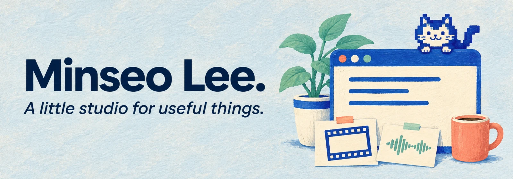
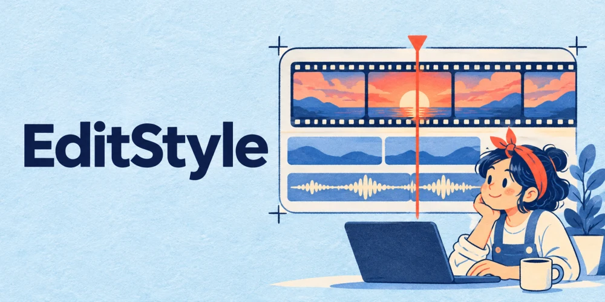
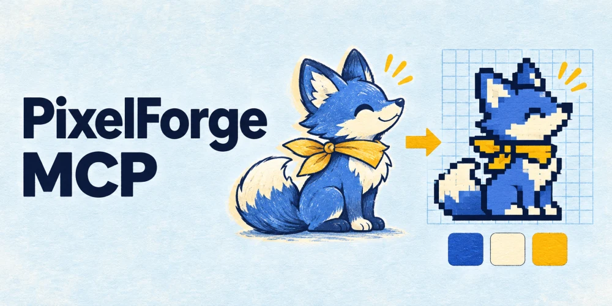
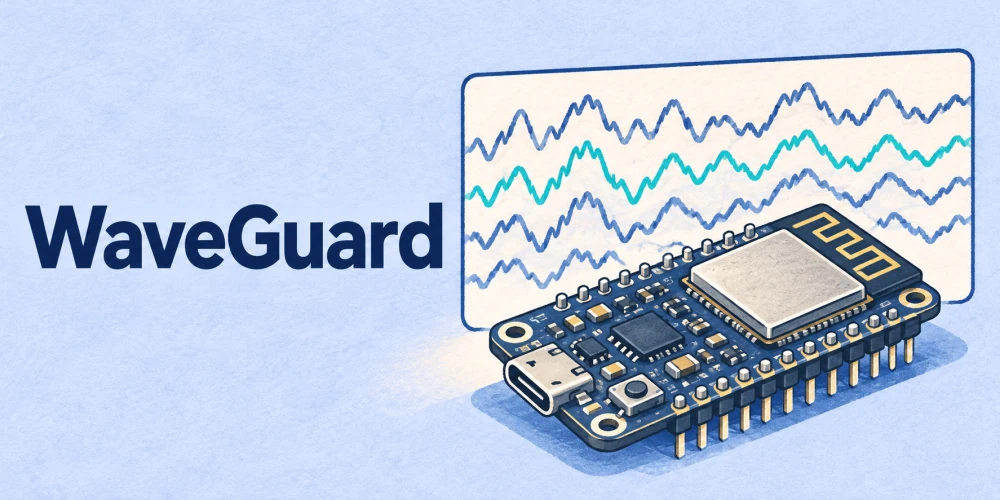
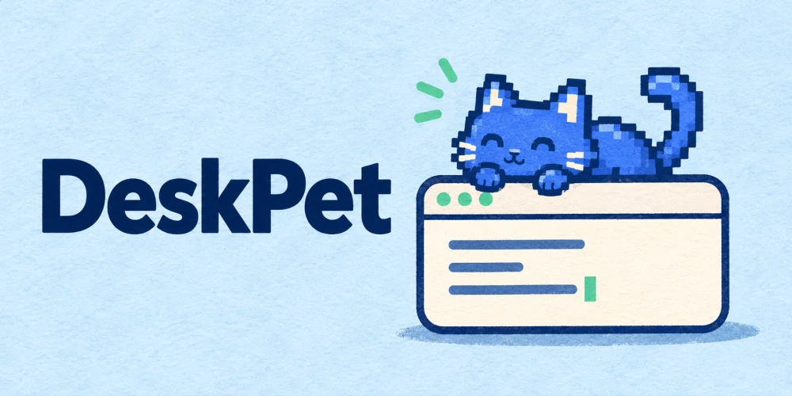

  
  <strong>AI TOP 100 (CAMPUS) · 2026&nbsp;Finalist</strong> 
  One of 100 finalists selected from 3,000 students.

 

  

  I build AI products, local-first tools, and game-asset pipelines. 
  <a href="https://neuralab.kr"><strong>Neural Lab ↗</strong></a>
  &nbsp;&nbsp;·&nbsp;&nbsp;
  <a href="mailto:mindsurf0176@gmail.com"><strong>Say hello ↗</strong></a>

## On my workbench

<table>
  <tr>
    <td width="50%" valign="top">
      
      
<a href="https://github.com/mindsurf0176/editstyle"><strong>EditStyle ↗</strong></a> 
      Describe an edit in a sentence and render the video locally.

    </td>
    <td width="50%" valign="top">
      
      
<a href="https://github.com/mindsurf0176/pixelforge-mcp"><strong>PixelForge MCP ↗</strong></a> 
      Turn illustrations into pixel sprites with a shared palette.

    </td>
  </tr>
  <tr>
    <td width="50%" valign="top">
      
      
<a href="https://github.com/mindsurf0176/waveguard"><strong>WaveGuard ↗</strong></a> 
      Replay Wi-Fi CSI recordings and inspect their waveforms.

    </td>
    <td width="50%" valign="top">
      
      
<a href="https://github.com/mindsurf0176/deskpet"><strong>DeskPet ↗</strong></a> 
      A <a href="https://github.com/mindsurf0176/deskpet/releases/tag/v1.3">macOS desktop pet</a> that reacts as your coding agent works.

    </td>
  </tr>
</table>

  Made with care, by Minseo.

