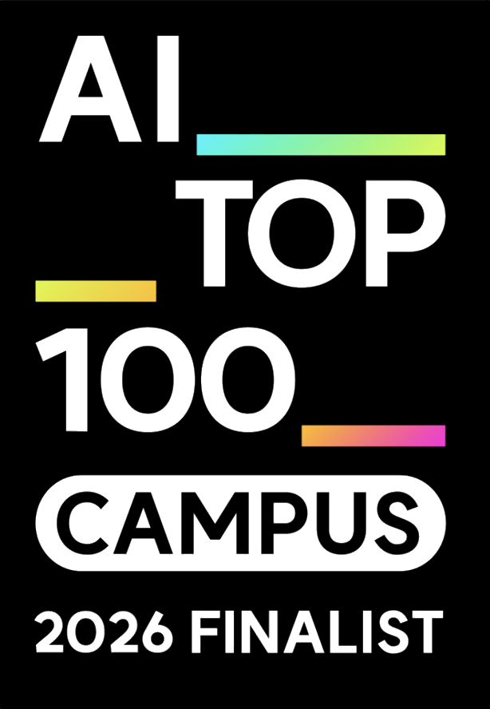
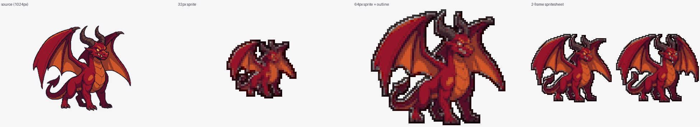
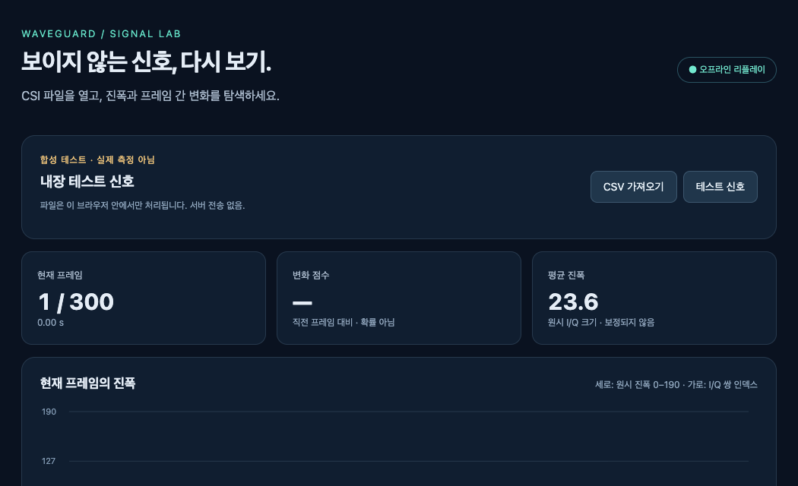
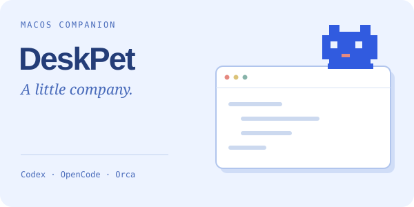
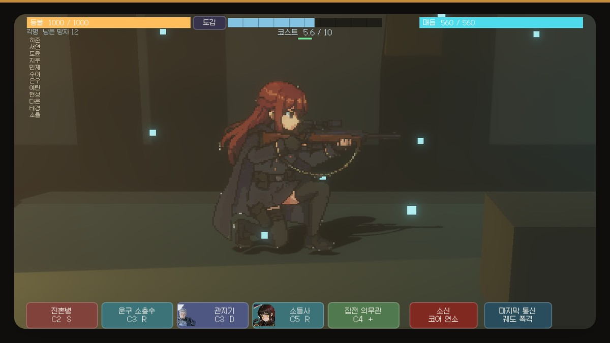
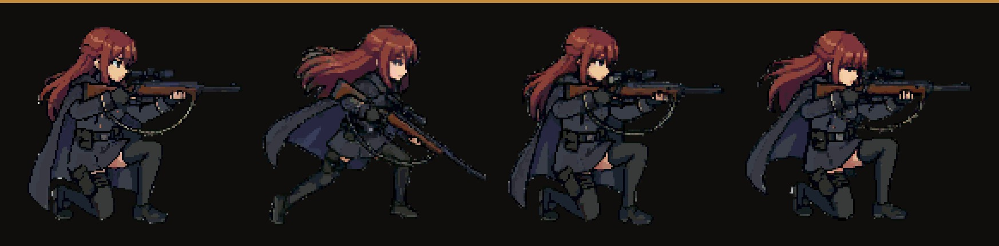

<strong>이민서 · Minseo Lee</strong>

<h1 align="center">AI TOP 100 (CAMPUS)</h1>

  

  <strong>2026년 4월 카카오 AI TOP 100 CAMPUS 본선 진출</strong> 
  학생 약 3,000명이 예선에 참여했고, 100명이 본선에 올랐습니다.

## 대표 제품

<table>
  <tr>
    <td width="150" align="center"></td>
    <td><strong><a href="https://github.com/mindsurf0176/editstyle">EditStyle</a></strong> 영상에 원하는 편집을 문장으로 적으면 컷·자막·색 보정 등을 적용하는 로컬 AI 편집 도구. 이전 이름은 CutAI.</td>
  </tr>
  <tr>
    <td width="150" align="center"></td>
    <td><strong><a href="https://github.com/mindsurf0176/pixelforge-mcp">PixelForge MCP</a></strong> AI 일러스트를 게임용 도트 스프라이트로 바꾸고, 팔레트를 맞춰 스프라이트 시트로 내보내는 MCP 서버.</td>
  </tr>
  <tr>
    <td width="150" align="center"></td>
    <td><strong><a href="https://github.com/mindsurf0176/waveguard">WaveGuard</a></strong> Wi-Fi CSI 신호의 변화를 브라우저에서 재생하는 시각화 실험. 합성 샘플과 ESP32 CSV를 불러올 수 있습니다.</td>
  </tr>
  <tr>
    <td width="150" align="center"></td>
    <td><strong><a href="https://github.com/mindsurf0176/deskpet">DeskPet</a></strong> 코딩 에이전트가 일하면 뛰고, 권한 요청에선 기다리는 macOS 데스크톱 펫.</td>
  </tr>
</table>

다른 공개 프로젝트

[RelayCode](https://github.com/mindsurf0176/relaycode) · [AssetForge](https://github.com/mindsurf0176/assetforge) · [typad](https://github.com/mindsurf0176/typad) · [Kotoba](https://github.com/mindsurf0176/kotoba) · [Fissh](https://github.com/mindsurf0176/fissh)

[**Vesper**](https://github.com/mindsurf0176/vesper) · Godot 스프라이트 애니메이션과 런타임 검증

[Neural Lab](https://neuralab.kr) · [작업 기록](https://minseo-log.vercel.app) · [이메일](mailto:mindsurf0176@gmail.com)
